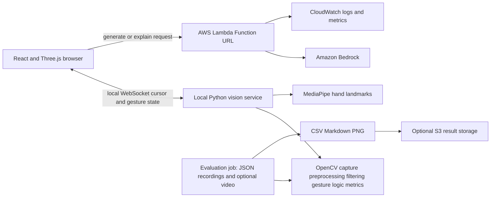

# SeeLearn

SeeLearn is a browser-based conceptual engineering assembly viewer. It opens bundled scene samples, accepts validated generated scene specifications from an optional AWS backend, and supports mouse interaction or a local Python hand-gesture service.

## Architecture



MediaPipe supplies hand landmarks. OpenCV handles camera capture, frame flipping and resizing, optional CLAHE preprocessing, Kalman smoothing, gesture logic, cursor metrics, and the video evaluation pipeline. The Python service sends cursor and gesture packets over a local WebSocket; webcam frames are not sent to AWS. When the vision service is unavailable, the browser retains mouse interaction.

The browser can open four bundled specifications: racing drone, DC motor, smartphone, and DDR5 RAM. Demo Mode forces prompt submissions to resolve to a bundled sample and avoids calling the generation endpoint.

## Versions

These are the installed Python package versions recorded from the project environment. OpenCV reports `cv2.__version__` as `5.0.0`; its installed distribution version is `opencv-python==5.0.0.93`.

| Package | Pin |
|---|---|
| Python | 3.11.9 |
| opencv-python | 5.0.0.93 |
| MediaPipe | 0.10.9 |
| protobuf | 4.25.3 |
| NumPy | 2.4.6 |
| websockets | 17.1 |
| matplotlib (evaluation) | 3.10.9 |

The Python service pins are in `vision_service/requirements.txt`; evaluation pins are in `eval/requirements.txt`.

## Setup

### Browser

Install the Node dependencies, configure the optional environment values below, and start Vite:

```sh
npm install
npm run dev
```

Open the local address printed by Vite. Use the sample cards or enable Demo Mode for a network-independent presentation.

### Local vision service

Create and activate a Python environment, then install the pinned dependencies and start the service:

```sh
python -m pip install -r vision_service/requirements.txt
python vision_service/seelearn_vision.py
```

To record a labeled clip for evaluation:

```sh
python vision_service/seelearn_vision.py --record eval/clips/still_01.json --label "still hand"
```

The service requires a usable local camera and OS camera permission. It does not upload camera frames.

### AWS backend

The backend is defined in `aws/` and uses a Lambda Function URL with Amazon Bedrock. Follow `aws/README.md` for prerequisites, model access, and deployment steps. Set the deployed Function URL as `VITE_AWS_API_ENDPOINT` in the browser environment. The backend writes its operational logs through Lambda's CloudWatch integration. Deployment requires AWS account authorization and may incur charges.

### Evaluation

Install the evaluation dependencies and run against real recordings:

```sh
python -m pip install -r eval/requirements.txt
python eval/evaluate.py
```

Place JSON recordings in `eval/clips/`. The evaluator writes measured results to `eval/results/`. For image-based preprocessing ablation, also provide matching video recordings and pass `--video PATH --label LABEL`. Evaluate the deployed generator with:

```sh
python eval/test_generation.py https://YOUR_LAMBDA_FUNCTION_URL/
```

This sends requests to the supplied live endpoint and writes latency and outcome files. EC2 and S3 steps are in `eval/run_on_aws.md`.

## Frontend environment

| Variable | Purpose | Example |
|---|---|---|
| `VITE_AWS_API_ENDPOINT` | Optional deployed Lambda Function URL. Leave empty for samples and offline behavior. | `https://example.lambda-url.region.on.aws/` |
| `VITE_VISION_WS_URL` | Local vision service WebSocket address. | `ws://localhost:8765` |

Only these frontend variables are required by the browser application. AWS deployment configuration is documented in `aws/README.md`.

## Limitations and responsible use

- Generated and bundled assemblies are conceptual teaching visuals. They are not manufacturing drawings, safety guidance, or certified engineering designs. Verify critical details independently.
- Generation depends on the deployed backend and model availability. Scene validation constrains the output format but does not establish engineering correctness.
- Harmful-topic refusal is implemented as a limited backend topic filter; it is not a complete safety classifier.
- Camera capture and landmark processing run locally. The local browser connection receives cursor and gesture information; video frames are not sent to the backend.
- Gesture recognition depends on camera access, lighting, framing, and hand visibility. Mouse controls remain available.
- Evaluation output is based only on supplied recordings and endpoint responses. Missing recordings or unavailable measures are reported as such; the repository does not include benchmark results.
